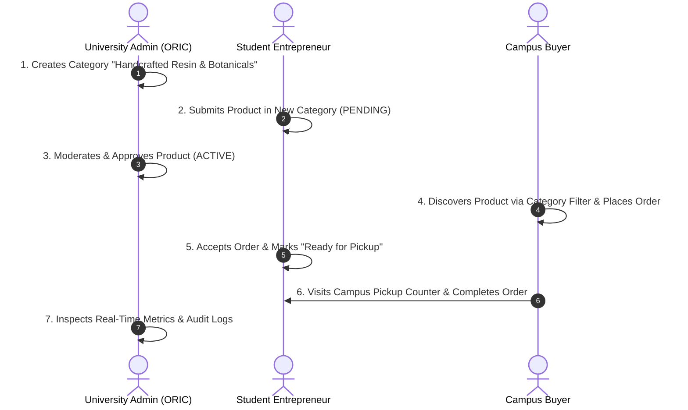

# JUW MARKETPLACE — UNIVERSITY EVALUATION PRESENTATION & LIVE DEMO GUIDE

**Target Audience:** Academic Evaluators, ORIC Directorate, Department Heads, and Technical Review Committee  
**Project:** JUW Entrepreneurial Marketplace (Jinnah University for Women)  
**System Version:** Production Release 2.4.0 (Full-Stack Dynamic Commerce Suite)  
**Date:** October 2026  

---

## 1. PRESENTATION OVERVIEW & VALUE PROPOSITION

### 3-Minute Elevator Pitch for Evaluators
> *"Good morning, respected professors and evaluation committee members. Today, we are proud to present the **JUW Entrepreneurial Marketplace** — a state-of-the-art campus commerce and incubation ecosystem engineered specifically for **Jinnah University for Women**.*
>
> *Our female students across Textile Design, Visual Arts, Food Sciences, Computer Science, and Business produce extraordinary crafts and products. However, their initiatives were previously confined to fragmented WhatsApp groups and personal social media pages with no buyer trust, no institutional moderation, and high transaction confusion.*
>
> *The JUW Marketplace resolves this through a full-stack, secure, multi-tenant digital platform featuring dedicated experiences for **Customers**, **Student Sellers**, and **University Administrators**. It incorporates automated product moderation, real-time campus pickup logistics, atomic stock management, Cloudinary media optimization, and a production-grade **Dynamic Category Management System** with 100% orphan-safe data integrity."*

---

## 2. PRE-DEMO ENVIRONMENT SETUP

Before starting the live demonstration, ensure both local microservices are active:

| Service | Protocol / URL | Startup Command | Verification |
| :--- | :--- | :--- | :--- |
| **Frontend Web App** | `http://localhost:5173` | `npm run dev` (in `juw-shop`) | Browser opens homepage with hero video |
| **Node.js API Server** | `http://localhost:4000` | `node --env-file=.env index.mjs` (in `juw-shop/server`) | Logs: `JUW API listening on 4000; Firebase configured: true` |

### Evaluation Credentials Ready at Hand
- **Admin Portal URL:** `http://localhost:5173/admin`
- **Super Admin Credentials:** Pre-authenticated via Firebase service credentials or configured Admin UID (`AiBU3zLcpXWPM4osYn2kFnpPt7l2`).
- **Seller Portal URL:** `http://localhost:5173/seller/portal`
- **Customer Storefront:** `http://localhost:5173`

---

## 3. STEP-BY-STEP LIVE DEMO SCRIPT (FULL COMMERCE LIFECYCLE)

Follow this 7-step sequence to demonstrate the end-to-end commerce lifecycle to evaluators:

---

### ACT 1: Dynamic Category Creation by University Admin
**Goal:** Prove to evaluators that categories are fully dynamic, cloud-persisted, and require zero developer code changes.

1. In your browser, navigate to:  
   `http://localhost:5173/admin/categories`
2. **Point out to the committee:**
   - The newly integrated **Categories** navigation item under *Operations & Moderation* with live badge counter.
   - Filter tabs: **All**, **Active**, **Hidden**, and **Archived**.
   - Search bar filtering categories in real-time.
   - Dynamic approved product counters next to each category.
3. Click the burgundy **"+ Add Category"** button.
4. Fill in the modal:
   - **Category Name:** `Handcrafted Resin & Botanicals`
   - **Slug:** Notice that `handcrafted-resin-botanicals` is automatically generated!
   - **Department:** Select or type `Dept. of Visual Studies & Arts`.
   - **Icon:** Click through the Lucide icon picker and choose `Sparkles` or `Palette`.
   - **Banner Image:** Click **Upload Image** and select a photo (automatically optimized via Cloudinary).
   - **Description:** *"Exquisite student-crafted resin bookmarks, coasters, and floral jewelry preserved in crystal resin."*
   - **Featured on Homepage:** Check the toggle switch to `Yes`.
5. Click **"Create Category"**.
6. **Key Evaluator Takeaway:** The category appears immediately in the table with `0` products and status `Active`. Document is verified in Firestore `categories` collection in real-time.

---

### ACT 2: Student Seller Listing in the Dynamic Category
**Goal:** Demonstrate that the newly created category instantly propagates to student sellers without restarting any server or redeploying code.

1. Open a new tab and navigate to:  
   `http://localhost:5173/seller/portal`
2. Scroll to the **"Add New Product"** section.
3. In the **Category** dropdown, open the options.
4. **Point out to the committee:** `Handcrafted Resin & Botanicals` is available in the dropdown immediately!
5. Fill in the product details:
   - **Title:** `Pressed Daisy Resin Bookmark`
   - **Price (PKR):** `450`
   - **Stock Quantity:** `10`
   - **Description:** *"Handmade bookmark featuring natural campus-grown daisies preserved in UV-resistant crystal resin with a silk gold tassel."*
   - **Category:** Select `Handcrafted Resin & Botanicals`.
   - **Product Photos:** Upload a sample product image.
6. Click **"Submit Listing for Review"**.
7. **Point out to the committee:** The product appears in the seller's dashboard with a yellow badge: **`PENDING REVIEW`**.
8. Switch to the public store (`http://localhost:5173/shop`) and show that the product is **NOT** visible to customers yet — proving strict institutional quality moderation!

---

### ACT 3: Institutional Moderation & Admin Approval
**Goal:** Show how the university maintains quality control over student commerce.

1. Switch back to the Admin Portal tab:  
   `http://localhost:5173/admin/products`
2. The product `Pressed Daisy Resin Bookmark` is sitting at the top of the **Pending Queue**.
3. Click the product row to inspect:
   - Evaluators can see student merchant name, department affiliation, price, and photos.
4. Click **"Approve & Publish"**.
5. Switch to `http://localhost:5173/admin/categories`:
   - Point out that `Handcrafted Resin & Botanicals` now shows **1 approved product** dynamically calculated!

---

### ACT 4: Customer Discovery & Campus Pickup Checkout
**Goal:** Demonstrate the student/faculty customer shopping experience and localized campus logistics.

1. Open the public storefront: `http://localhost:5173`
2. **Highlight UX Features:**
   - **Cinematic Homepage Hero:** Point out the smooth playback of `/juw-hero.mp4`, the official **JUW Logo**, and the **JUW Marketplace** badge.
   - **Category Mega Bar:** Hover over the "Categories" dropdown in the navbar — `Handcrafted Resin & Botanicals` appears with its `Sparkles` icon and `1 Product` counter.
3. Click on the category or navigate to `http://localhost:5173/categories`:
   - Click on the `Handcrafted Resin & Botanicals` card to open `/categories/handcrafted-resin-botanicals`.
4. Click on `Pressed Daisy Resin Bookmark` and click **"Add to Cart"**.
5. Open the Shopping Cart drawer (`http://localhost:5173/cart`) and proceed to **Checkout**:
   - Customer enters Name: `Fatima Zahra`
   - Student/Staff ID: `JUW-CS-2024-042`
   - Contact Phone: `0300-1234567`
   - **Campus Pickup Location:** Select `JUW Main Campus - Incubation Hub Counter (Block C)`.
   - **Payment Method:** `Cash on Campus Pickup (COD)`.
6. Click **"Place Order"**.
7. An order confirmation screen displays:
   - Order Number: `JUW-ORD-XXXX`
   - **Campus Pickup Verification PIN:** e.g., `834192`.

---

### ACT 5: Seller Order Processing & Campus Fulfillment
**Goal:** Demonstrate seller operations and inventory decrement.

1. Switch back to the Seller Portal: `http://localhost:5173/seller/portal`
2. Navigate to the **Orders** tab:
   - Order `JUW-ORD-XXXX` is displayed with status **`PENDING`** and delivery location `Incubation Hub Counter (Block C)`.
3. The seller clicks **"Accept Order"** (status updates to `ACCEPTED`).
4. The student prepares the bookmark with packaging, then clicks **"Mark Ready for Pickup"**.
5. Customer can open `http://localhost:5173/track-order`, type `JUW-ORD-XXXX`, and see real-time progress: *"Ready for Collection at Incubation Hub Counter Block C"*.

---

### ACT 6: Campus Collection, Cash Settlement & Audit Log
**Goal:** Complete the transaction cycle and demonstrate auditability.

1. At the pickup counter, the order is handed over and paid in cash.
2. Seller marks the order as **"Completed"**.
3. Switch to the Admin Portal:
   - `http://localhost:5173/admin`: Total platform GMV (PKR) and transaction counts increment.
   - `http://localhost:5173/admin/audit-logs`: Review the audit stream showing exact timestamps and actors for category creation, product approval, and order transitions.

---

### ACT 7: Data Integrity & Safe Category Deletion Rule (Crucial for Technical Evaluators!)
**Goal:** Prove to software architecture evaluators that the system prevents orphaned records.

1. Go to `http://localhost:5173/admin/categories`.
2. Find `Handcrafted Resin & Botanicals` (which currently has 1 active product).
3. Attempt to delete it by clicking the red **Delete** icon.
4. **Point out the Safety Dialog to Evaluators:**
   - The system intercepts the deletion and announces:  
     *"Cannot delete category. It is currently assigned to 1 active product(s)."*
   - Evaluators are shown two safe architectural options:
     - **Option 1: Soft Archive:** Category is hidden from public view, but existing orders and products stay linked safely.
     - **Option 2: Reassign Products:** Admin selects another category (e.g., `Art & Wall Hangings`), atomically moving the student's bookmark to the new category before safely deleting the old one.
5. Demonstrate safe reassignment: Select `Art & Wall Hangings` and confirm.
6. The old category is removed, and the bookmark is automatically remapped to `Art & Wall Hangings` without a single broken link or database corruption!

---

## 4. EVALUATION CRITERIA & ARCHITECTURAL HIGHLIGHTS

When evaluators ask technical questions, refer to these empirical architectural decisions:

### Q1: "How do you protect administrative routes from unauthorized users?"
> **Answer:**  
> *"We implement defense-in-depth across both client and server layers. On the client, `AdminAuthGate.tsx` inspects verified JWT token claims before mounting the layout. On the server, `server/index.mjs` verifies the cryptographic signature of the Bearer token against Google Firebase public keys on every request. Even if an attacker counterfeits client state, unauthorized requests return immediate **HTTP 401 Unauthorized** or **HTTP 403 Forbidden** as proven in Scenario 12 of our automated test suite."*

### Q2: "What happens if two admins create categories with the same slug?"
> **Answer:**  
> *"Our backend performs collision detection against Firestore before persistence. If a slug already exists, the server immediately returns **HTTP 409 Conflict** with an explicit error message, preventing route collisions in React Router as proven in Scenario 11."*

### Q3: "How is image storage handled without bloating server storage?"
> **Answer:**  
> *"We integrated the Cloudinary Cloud CDN. The server enforces a 2.8 MB payload boundary, streams base64 images into scoped folders (`juw-marketplace/categories` and `juw-marketplace/products`), and stores only lightweight, immutable CDN URLs in Firestore. Images are automatically transformed for optimal mobile compression (`f_auto, q_auto`)."*

### Q4: "How does the system ensure zero orphaned products?"
> **Answer:**  
> *"Unlike basic CRUD apps that execute destructive deletes, our deletion handler enforces institutional data integrity. Destructive deletes on populated categories are blocked with HTTP 400. Admins are offered either soft archival or an atomic batch update that reassigns all active products to a valid destination category before record cleanup."*

---

## 5. SUMMARY CHECKLIST FOR PRESENTERS

- [ ] Both Vite dev server (`:5173`) and Node server (`:4000`) running.
- [ ] Browser window open with tabs: Customer Home, Seller Portal, Admin Categories, and Admin Products.
- [ ] Sound/speakers checked for hero video playback if presenting in an auditorium.
- [ ] `JUW_MARKETPLACE_FINAL_REPORT.md` opened in IDE as technical reference.
- [ ] Automated test output (`13/13 Scenarios Passed`) ready to show in terminal as empirical proof.
